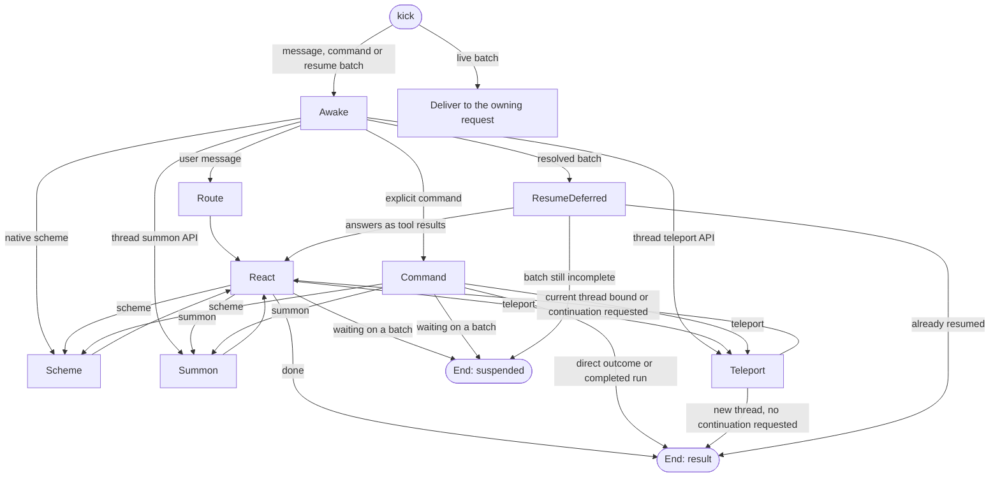

# The reflex graph

A message arrives, an answer goes out, and between the two something decides which
agent runs, where, with what context, and what happens when the agent stops to ask.
That something is the reflex graph, a [pydantic-graph](https://ai.pydantic.dev/graph/)
in `octomate/reflex/`.

## Declared, not dispatched

Every edge comes from a node's own `run` return annotation. A node that can hand
off is typed as returning `Summon`; one that ends returns `End`. There is no
dispatcher table, so the graph's shape is read off the nodes, and the builder
validates that every node is reachable from the entry.

## The nodes

**Awake** resolves the signal once and writes the source context into state. Five
signals enter here: a user message from a channel, a resolved action batch coming
back from a card, a spell a native session cast over MCP, and an authenticated
thread operation the console asked for, validated by the gateway, and an explicit command on a resolved conversation. A thread
operation, and a native session's teleport of its own thread, enter at the thread
they act on and go to `Summon` or `Teleport` directly. `Awake` consumes its signal into resolved run context; downstream
nodes do not retain the signal. A UI teleport opens a fresh turn with an address notice; it
does not fabricate a deferred tool result. A message
enters the thread its address names, or a fresh sub-thread when the address is a
chat room. See [Threads and chat rooms](../usage/threads.md).

**Route** decides who runs this turn, in order: the agent a handoff already pinned
on the chat; the channel's default agent when the message is already in a flat
thread; otherwise the channel's default agent, in the same conversation, with no
handoff recorded, because a group's main surface is never pinned. There is no
separate triage pass: the entry agent self-routes with the gateway if it wants to.

**React** starts ordinary agent runs. It resolves the agent against the
channel the run will happen on, records the handoff if one is pending, mounts the
gateway and the user's capabilities, registers the session at the gateway so a
second concurrent turn is refused, then runs the agent. The run always streams,
whatever the channel: what it does goes out on the nerve as it happens, and the
channel decides whether to draw it live or only its reply. After the run it reads what the
gateway recorded: a summon becomes `Summon`, a scheme becomes `Scheme`, a teleport
deferral becomes `Teleport`, any other deferral ends the graph suspended, and a
plain result ends it. Whatever happened, the turn's workspace is saved.

**Command** executes the selected runtime command directly, bypassing `Route` and
chat prompt construction. The node enters the manager's `validate` scope, prepares
the user directly, then calls `execute`. The validation scope holds the turn guard
through setup and execution. Refused and replayed deliveries skip user preparation;
execution records the receipt before invoking the agent. A setup failure releases
the guard without recording a command. Direct output is presented as command
feedback and ends
with a `CommandResult` or `CommandError`, without a model run. A command that
starts agent work keeps that same invocation open while Reflex consumes its
events; it never calls `agent.run` a second time. Direct commands leave the summon
decision unset. An agent stream or deferral creates its continuation decision
when needed, preserving the selected agent and model for resume or teleport.

`React` and `Command` use the stateless `ctx.deps.runtime` service for gateway
capabilities, deferred approvals, publishing the run, reply bindings and post-run
transitions. State records the selected agent/model and conversation. Each entry
creates its own session, suspender and capability list; the runtime retains none
of them across handoffs. Both
streaming and non-streaming channels receive replies. A command's actual agent
run can hand off, scheme or teleport, and deferred batches resume through the
existing `ResumeDeferred` path. Accepted command attempts save their workspace on
exit; rejected and replayed deliveries do not prepare user tools or save it.
The inner React graph and its stream contract remain dedicated to agent runs.

Commands submitted through the HTTP API enter this graph for both Trunkline and
IM destinations. Reflex publishes direct feedback, agent output and approval
requests on the nerve, where the destination channel draws them and a console
watching the thread sees them; the HTTP caller receives completion after the graph
finishes.

Explicit command receipts stay in the visible ledger but are omitted from pending
chat input and automatic room recaps. Their arguments are not another chat turn.

**Summon** hands the current conversation to the agent the decision names, where
it is, then re-enters `React` with the brief as the new agent's prompt. Moving a
conversation elsewhere is `Teleport`'s.

**Scheme** opens the asking user's direct messages with the hint, finds who already
owns that DM or falls back to that channel's default agent, and re-enters `React`
as an ordinary hand-off with the brief.

**Teleport** carries the same agent somewhere else: asks the channel to create a
thread at the prepared address, forks the conversation's messages into the landed thread, binds the
project and forks its workspace if one was named, or carries the source thread's
project and the tree it stands at when none was, relocates the agent's session,
and re-enters `React` when there is more to do there: the console's prompt,
recorded as the user's message, or, when the agent asked to carry on, the teleport
call answered by a sentence saying where it now is. Otherwise the move ends there,
with the handoff recorded and the workspace saved. A failed open refuses the move; it does not resume at the source.
Binding a project workspace to the current thread always re-enters `React`, so
the task continues as soon as the workspace is ready.
For native history, `Awake` asks the receiving agent to validate the source before
entering `Teleport`, so an unusable transcript cannot create or announce a destination.

**ResumeDeferred** takes a resolved batch, rebuilds the target from what the batch
persisted, finds the thread through the conversation rather than the address (a
chat-room kick ran in a sub-thread), restores the user's profile so the resumed run
keeps the same capabilities and prompt prefix, and re-enters `React` with the
batch's answers as tool results and no new prompt.

## Publishing, not presenting

The graph draws nothing. A kick opens a stream on the nerve, asked on the thread
the signal came from, and everything the graph does goes out on it as it happens:

- The reflex wakes before anything else and falls asleep last, whatever happened:
  `reflex_awake` and `reflex_asleep` bracket the whole kick. A thread or chat
  room holds one reflex at a time: a kick asked on one whose reflex is still
  awake is refused before it wakes.
- Each agent run is bracketed by `run_started`, which names the thread the run
  reports into, and `run_ended`. One kick can hold several runs: a summon runs the
  new agent after the first, and a teleport can resume where it landed.
- A move leaves its line in the chat it left, a send lands where it was sent, and
  a turn that fails reports its error where it came from.

The graph records before it publishes: a run's reply, a move's line and a send
delivered somewhere else are rows in the ledger before their events go out, and
each event names its row, so the channel that draws it can mark it with the
platform id it got. A rendering that fails cannot fail the turn.

Each event is heard on the thread it happens at, by that channel and by any
console watching the thread, and on the thread the kick was asked on, so a console
follows the kick wherever a move takes it. Something sent to a person's private
surface, a send into their direct messages or an authorization link, is heard
only where it lands. See [Feelers](feelers.md#the-siphon) for how a channel
draws what reaches it.

## Suspending and resuming

A run ends suspended when its output is a set of deferred tool requests the run
could not resolve itself. The suspender classifies them by the metadata each
deferral declares, never by tool name: a `teleport` kind goes back to the graph, and
everything else becomes a persisted **batch** with every address, mode and decision
the graph needs to come back. A teleport has already passed the agent's own
permission check by then, so nothing asks about it again. The batch goes out on
the run's stream as one event, and the channel presents its cards wherever it
draws the run.

The batch is a row. When the cards are answered, possibly after a restart, the
channel kicks the graph with the batch id, `ResumeDeferred` rebuilds the state from
the row, and `React` resumes the agent's conversation. Inkling resumes through the
graph with the answers as tool results; a harness that takes no tool result back
is given the answers as its next prompt. An agent that parks a live process
instead, as the harness bridges do, pauses on the suspender rather than ending.
Each batch records which it is: `resume` re-enters the graph; `live` delivers the
answer to the waiting agent. A live batch whose agent is no longer waiting is an
error, never a reason to start another run. The agent is waiting before the
batch's cards are shown, so an immediate response reaches it. Once a batch is
answered, the answer goes out as well, from the live run that takes it or from
`ResumeDeferred`, so a console still showing the cards marks them answered.

## The inner graph

Inkling has a second, smaller graph per turn: start or resume, run the agent,
resolve deferrals. A deferral is first offered to the conversation's posture, which
under `dontAsk` or `bypassPermissions` answers it in process, and only what is left
reaches the suspender. That is why an Inkling run can keep going through an
approval that the posture already granted, and why a whole batch goes to the human
when any part of it needs one.

The graph runs inside a single `kick`, under one Arcanus materia context, with
Logfire spans per node, and publishes on the stream that kick opened. The state
object carries the resolved source, the target, the pending handoff, the user
profile and the prompt; nodes read it and carry only transition discriminators of
their own.
